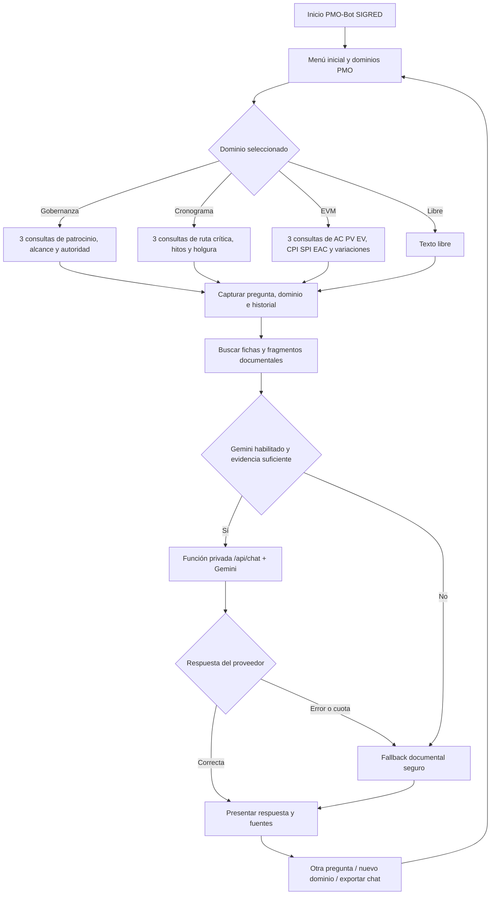

# PMO-Bot SIGRED · Ampliación de dominios PMO (V11)

## Menú inicial y acciones
El inicio conserva los ocho accesos originales. Se incorporan tres tarjetas: **Gobernanza y estrategia**, **Cronograma y ruta crítica** y **Costos y valor ganado (EVM)**. Los mismos tres dominios aparecen en un submenú permanente, incluso después de iniciar una conversación.

Al seleccionar un dominio, se presentan **tres preguntas completas y seleccionables**. La consulta también se admite en lenguaje natural. El asistente responde con Gemini usando extractos del Informe Final Consolidado y vuelve a la base local si Gemini no está operativo.

## Variables capturadas

| Variable | Tipo | Uso | Almacenamiento |
|---|---|---|---|
| `question` | Texto, hasta 1200 caracteres | Consulta del usuario | Historial del navegador cuando la persona lo habilita |
| `topic` | Categoría (`pmo_gobernanza`, `pmo_ruta`, `pmo_evm`) | Enrutamiento de dominio | Conversación local |
| `history` | Últimos 8 mensajes resumidos | Resolver consultas de seguimiento | Solicitud temporal al backend |
| `mode` | `auto`, `ai`, `local` | Política de uso de Gemini | Preferencia del navegador |
| `memoryNote` | Texto opcional | Preferencia de presentación, no evidencia | Preferencia del navegador |
| `GEMINI_API_KEY` | Secreto del servidor | Autorización ante Google | Solo variable privada de Netlify |

**No se capturan** contraseñas ni números financieros como hechos oficiales. El bot no ejecuta pagos, modificaciones presupuestales ni aprobaciones institucionales.

## Decisiones y fallback

1. Detecta el dominio mediante botón o palabras clave.
2. Consulta las fichas del proyecto e índice de fragmentos citables por página.
3. Si el modo es `local` o Gemini está sin configurar, responde con una explicación metodológica sin inventar datos.
4. Si está activo, consulta Gemini a través de la **misma función segura** `/api/chat`; la clave jamás llega al navegador.
5. Si Gemini falla por cuota, timeout o clave no válida, se retorna una respuesta documental segura.
6. No se calculan CPI, SPI, EAC, holguras o ruta crítica sin entradas completas y verificables.
7. Si hay evidencia, la respuesta puede enlazar al PDF pertinente; la evidencia se debe contrastar.

## Diagrama de flujo / mapa de bloques

## Criterios de corrección de las consultas

**Gobernanza:** diferenciar objetivo estratégico de un resultado proyectado. No inferir patrocinador ni autoridad del director cuando no está formalmente asignada.

**Cronograma:** un listado de hitos no es prueba de una red CPM. La holgura requiere duración y precedencias; el retraso observado requiere fecha base y real con fecha de corte.

**EVM:** AC es costo realmente ejecutado, no presupuesto estimado. PV y EV se requieren en la misma fecha de corte. `CPI = EV / AC`, `SPI = EV / PV`, `CV = EV - AC`, `SV = EV - PV`. `EAC = BAC / CPI` es una opción condicionada a mantener el desempeño actual; no es la única fórmula posible. Los denominadores deben ser distintos de cero. La reserva de contingencia requiere registros de movimientos efectivos.

## Despliegue sin romper la conexión existente

1. Respaldar la versión publicada de Netlify.
2. Publicar **este ZIP completo** en el mismo repositorio y desplegar el mismo sitio Netlify.
3. **No reemplazar** los valores actuales de `GEMINI_API_KEY`, `GEMINI_MODEL` ni `ENABLE_PUBLIC_AI` de Netlify.
4. Entrar en Configuración y pulsar **Probar conexión Gemini**. Seleccionar Automático o Gemini prioritario.
5. Abrir cada uno de los tres dominios y ejecutar las nueve consultas. Verificar la indicación de respuesta generada por Gemini y los enlaces documentales; una respuesta local no demuestra una ejecución de la IA.

No es posible certificar la conexión de red con Google desde la ejecución local de pruebas; se valida efectivamente mediante el botón de prueba en el despliegue real.
